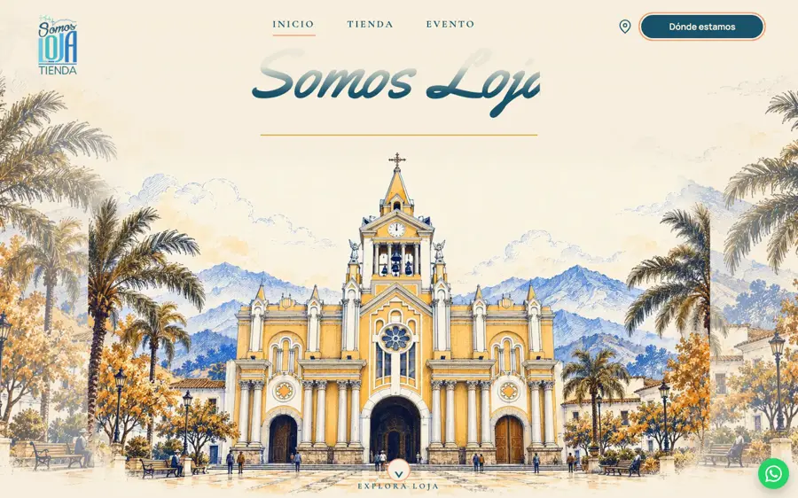
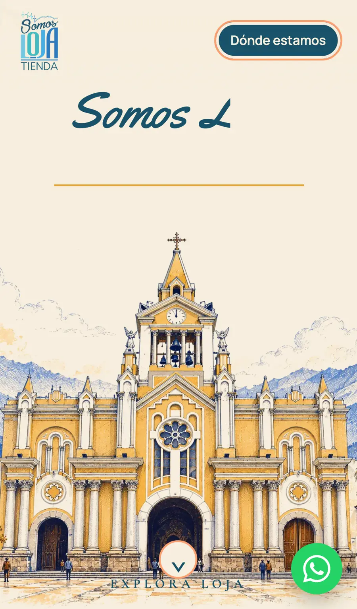
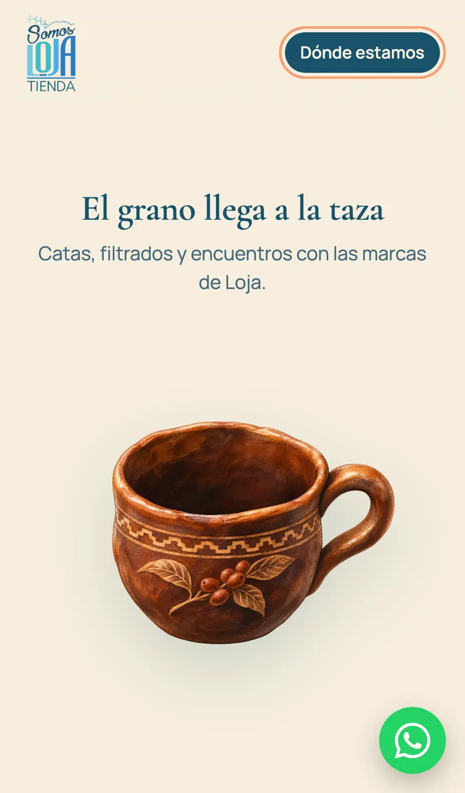
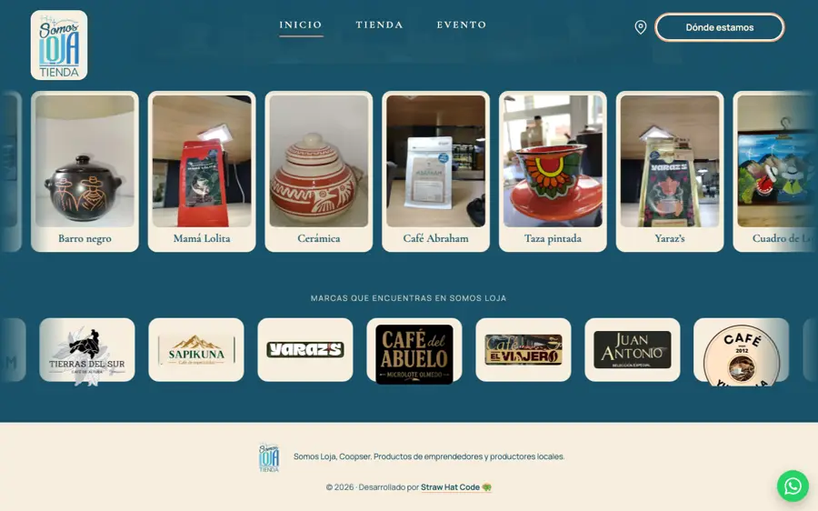
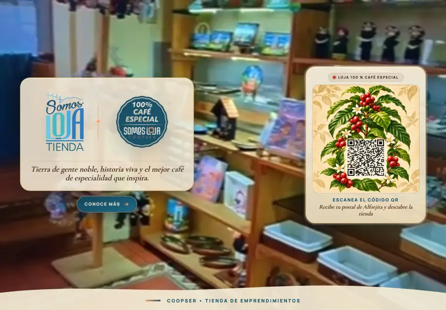
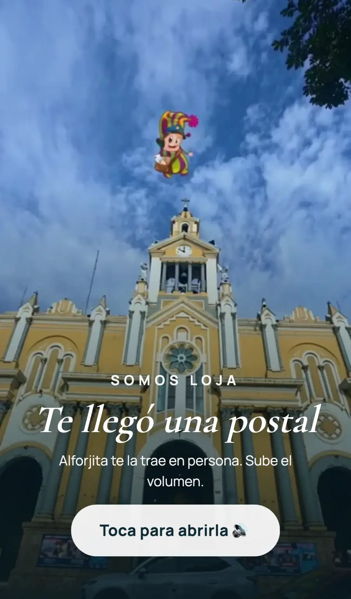
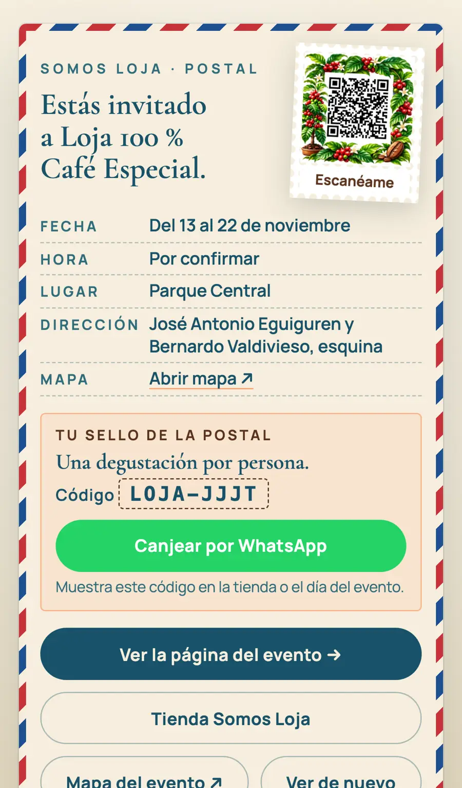
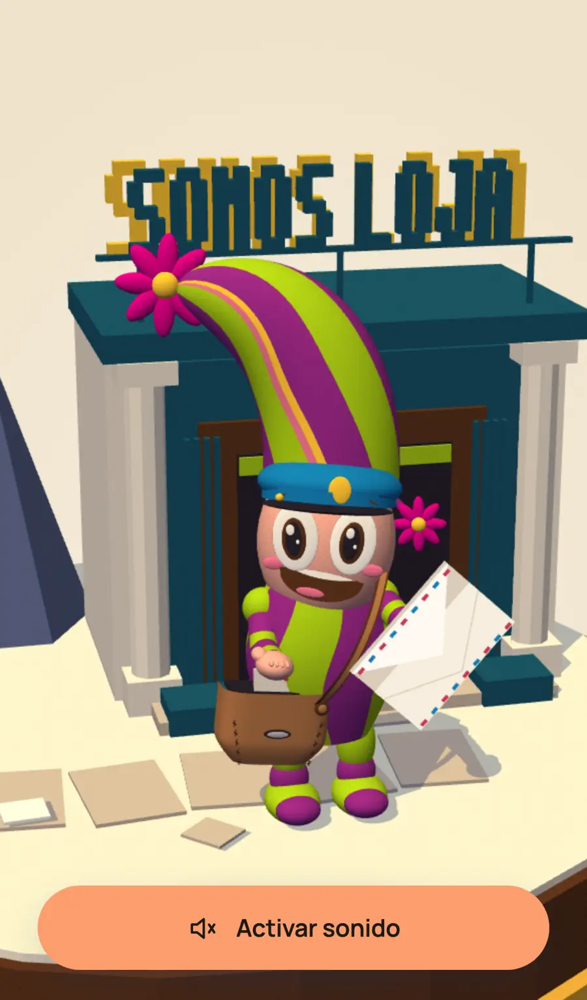

# Manual · Somos Loja Tienda × Loja 100 % Café Especial

Sitio publicado: **https://somos-loja-tienda.vercel.app**

Este manual explica cada página, para qué sirve, cómo se usa el día del evento y cómo se actualiza.

## Recorrido del visitante

```
Tablet en la tienda ──QR──▶ Postal de Alforjita ──▶ Código + "Canjear por WhatsApp"
                                   │                         │
                                   ├──▶ Página principal      └──▶ El equipo valida el código
                                   ├──▶ Tienda Somos Loja           y entrega la degustación
                                   └──▶ Mapa del evento
```

| Página | Dirección | Propósito |
|---|---|---|
| Página principal | `/` | Presentar la tienda, el proceso del café, el evento, productos y marcas. |
| Tablet | `/evento/` | Pantalla fija en la tienda: video de fondo y QR que lleva a la postal. |
| Postal de Alforjita | `/evento/postal/` | Invitación animada con código de canje por WhatsApp. |
| Invitación del cartero | `/evento/cartero/` | Versión alternativa de la invitación de Alforjita. |

---

## 1. Página principal (`/`)





**Secciones, en orden:**

1. **Inicio**: la catedral de Loja y los boletos del evento.
2. **Proceso**: capítulos del grano a la taza.
3. **Cascada del café**: los granos caen y llenan la taza.
4. **Evento**: el "50" formado con granos, fechas y lugar, y el enlace a la postal.
5. **Tienda**: dirección, teléfono, redes, mapa y recorrido en video.
6. **Productos**: carrusel con 16 productos.
7. **Marcas**: cinta infinita con 14 logos de marcas aliadas.



**Cascada en celular:** basta **un solo deslizamiento** para ver la animación completa (unos 3 s), aunque se suelte el dedo. Al volver hacia arriba se reinicia. En compu la animación sigue el scroll.



**Botón verde de WhatsApp:** aparece en todas las pantallas, abajo a la derecha. Abre WhatsApp (+593 96 294 7777) con un mensaje listo.

**Redes:** Instagram, Facebook y TikTok, en la sección Tienda.

---

## 2. Tablet de la tienda (`/evento/`)



- **Uso:** abrir `https://somos-loja-tienda.vercel.app/evento/` en la tablet, en horizontal y a pantalla completa.
- Muestra el video de la plaza de fondo, los logos Somos Loja y 100 % Café Especial, y el QR.
- **"Conoce más"** abre la postal en la misma tablet.
- **El QR** lo escanean los visitantes con su celular y los lleva a la postal.

> El QR es una imagen fija (`evento/recursos/qr-cafe-loja.webp`). Si cambia la dirección de la postal, hay que generar un QR nuevo.

---

## 3. Postal de Alforjita (`/evento/postal/`)



1. Aparece "Te llegó una postal". Al tocar **"Toca para abrirla"**, Alforjita la entrega con sonido.
2. Al final se ve la postal con los datos del evento.



**Canje:**

- Cada celular recibe su propio código, por ejemplo **LOJA-2HQU**, y lo conserva aunque recargue la página.
- **"Canjear por WhatsApp"** abre un chat con este mensaje: *"Hola Somos Loja, soy ____. Escaneé el QR y recibí la postal de Alforjita. Quiero canjear mi degustación con el código LOJA-2HQU."*
- **El día del evento**, la persona muestra el código o la postal y el equipo entrega la degustación.

> ⚠️ **Control manual:** no hay servidor que marque el código como usado. Quien atiende el WhatsApp o el puesto debe anotar los códigos ya canjeados para evitar repetidos.

**Botones al pie:** Ver la página del evento · Tienda Somos Loja · Mapa del evento · Ver de nuevo.

---

## 4. Invitación del cartero (`/evento/cartero/`)



Es la versión alternativa de la invitación, con Alforjita como cartero y un mapa del Parque Central. Su QR todavía dice "aún no activo".

---

## Cómo actualizar

| Quiero cambiar… | Archivo |
|---|---|
| Teléfono, redes, mensaje de WhatsApp, fechas | `absent-apogee/src/data/somos-loja.ts` |
| Productos del carrusel | `productos` en `somos-loja.ts` + imágenes en `public/carpeta-a-usar-web/galeria/` (800 px y versión `-400`) |
| Logos de marcas | `marcas` en `somos-loja.ts` + `.webp` en `public/carpeta-a-usar-web/marcas/` (160 px de alto) |
| Texto de canje o beneficio | `absent-apogee/public/evento/postal/index.html` (busca `Canjear`) |
| Tablet | `absent-apogee/public/evento/index.html` |

**Imágenes:** todo en `.webp`. El video de la tablet está comprimido a 3.6 MB.

**Publicar:**

```bash
cd absent-apogee
npm ci
node --test tests/*.test.mjs      # tests de la web
npx astro build                   # comprobar que compila
vercel --prod                     # publicar (proyecto somos-loja-tienda)
```

Los tests de la raíz (postal e invitación) se corren con `node --test tests/*.test.mjs` desde la raíz del repo.

## Pendientes

- Hora del evento: "Por confirmar".
- Logos limpios de Vallicoffee, Don Rey, Café Johann, Rottwy, Aurora y Mamá Lolita.
- Logo original de Juan Antonio, porque el actual tiene un pequeño retoque.
- Canje con validación real en servidor, si se necesita evitar canjes repetidos.
